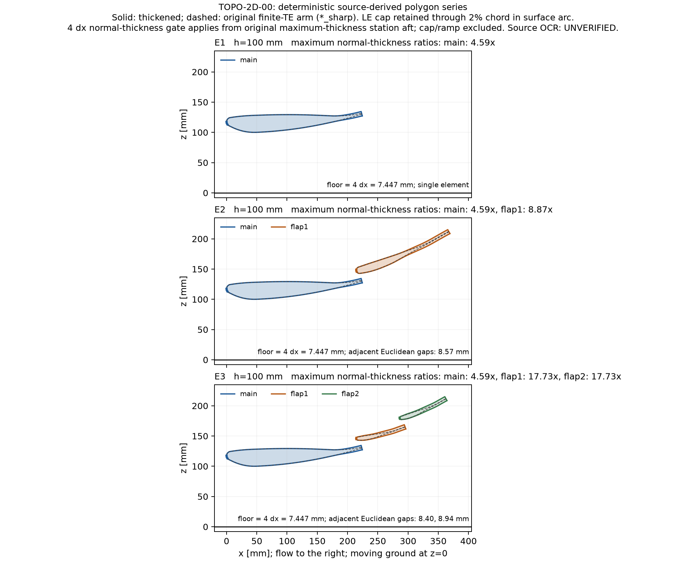

# WP4：TOPO-2D-00 WaterLily 側 報告

## 状態

PARTIAL。WP4 の最終 Python 試験 118 件と CPU 自己テスト 56 件は通ったが、既存 GRID-02 の
recursive freeze closure が新規 `src/cfd_sdf/topo2d/*.py` まで要求するため、過去の freeze を
再検証する 2 件が失敗する。clean base では同じ 3 件の限定比較が全て通り、commit 後の WP4 では
2 failed／1 passed。したがって「全体の失敗集合が base と同一」は達成していない。
凍結済み source／evidence を変更して回避していない。

実装とローカル CPU 検証を作成した。登録 rev 0 にある前縁と一様最小厚さの両立、
有限厚の原形に対する `sharp` の名称、`CONCORDANT_PARTIAL` の到達不能性は、下記のとおり
解釈と限界を明示した。登録文の変更、凍結、適格化の判定は行っていない。

WP4 の GPU job、Kaggle、RANS は実行していない。全体 pytest の既存 Metal test の import abort は
下記に別記する。既存 tracked ファイルの編集はなく、追加ファイルのみ。
開始点は `e3dcdf6188df6079e197eb28f7fcba1451ec512d`。
CPU 全体比較の実装 commit は `970d8fad90884b1e9bfa1470f4fa3f4f78a3a5ec`。
最終コード commit は `b68b3beea15efb10c343442c83ad14f42e19d87f`。
公開した [Draft PR #89](https://github.com/ramhachi/CFD_opt_sdf/pull/89) と
[保存した報告](https://github.com/ramhachi/CFD_opt_sdf/blob/feat/gen01-w1-04-topo2d-waterlily/docs/codex/gen01_w1_2026_11_06/reports/wp04_report.md) に同じ本文を記録した。
公開先は feature branch `feat/gen01-w1-04-topo2d-waterlily`、統合先は
`codex/kaggle-batch-migration`。PR は draft とし、auto-merge は有効にしない。

元 worktree の Git metadata は writable root の外にあり、index.lock の作成が拒否された。
元の branch ref・index は変更せず、`/private/tmp/topo2d00-wp04-final-publish` の独立 clone に
意図した追加ファイルだけをコピーして、同名 feature branch で commit／push した。
元 worktree では追加ファイルが untracked のまま残る。このローカル制約と remote の公開結果を
区別し、公開 tree と元ファイルの SHA 一致を別途検証する。

## 作ったもの（パス、1 行ずつ）

- `data/zz2003/{single_element_table2,main_element_table3,flap_table4}.dat`：公式 thesis の indexed OCR から転記した 44／44／18 行。出所・取得方法・単位・未画像照合を header と全数値行に記録。
- `docs/codex/gen01_w1_2026_11_06/reports/topo2d00_source_tables.txt`：転記照合に用いた公式 PDF の OCR 抜粋。
- `src/cfd_sdf/topo2d/geometry.py`：E1／E2／E3、厚さ生成、閉多角形 SDF、事前 gate、決定的 JSON／NPZ 出力。
- `docs/harness/topo2d00_scenes/*.json`：主格子 E1〜E3、原形 `*_sharp`、確認格子 E1／E2、高さ 80 mm の E1／E2、計 10 scene。
- `scripts/topo2d00/plot_geometry.py` と `reports/topo2d00_geometry.png`：3 系列の原形・厚くした形状・地面の比較図。
- `julia/topo2d/Topo2D.jl`、`scripts/waterlily_topo2d_job.jl`：解析多角形 AutoBody と移動地面を用いる 2D job。
- `scripts/topo2d_selftest.jl`：E1／E2 の短い CPU 実行、力、地面速度、位相、checkpoint と全 16 位相の核検査。
- `src/cfd_harness/scene_campaign.py`、`docs/harness/topo2d00_campaign.json`：v1.1 の scene 拡張、3 kernels／125 states、render／実行／再検証。
- `scripts/topo2d00/analyze.py`、`scripts/topo2d00/check.py`：凍結・入力検査、統計と順序付きラベル、独立再計算、written-once 出力。
- `reports/topo2d00_rans_result_schema.json`：WP5 と共有する RANS 結果の JSON Schema。
- `tests/topo2d00/*.py`：転記、幾何、campaign、解析、独立 checker の合成データ試験。
- `reports/wp04_design.md`：実装前の設計と、最終的に確認したインターフェースの補足。
- `reports/wp04_validation/`：コマンド・結果・source／artifact SHA を持つ検証記録。

上の `reports/` は全て `docs/codex/gen01_w1_2026_11_06/reports/` を指す。

## インターフェース（他 WP が使う関数・CLI・ファイル形式）

幾何は mm、流れは +x、上は z。`build_scene(configuration, height_mm=100, dx_mm=223.4/120, ...)`
が scene を返す。h は主翼素の最低点から地面までで、h/c1 と h/c の両方を記録する。
`scene_sdf(points, scene)` は各閉多角形への点–線分最小距離と winding による符号の min。
`write_scene(scene, json_path)`／`save_npz(scene, npz_path)` は pickle を使わない決定的出力。
実際の公開関数名・引数は source の docstring を参照すること。

overlap は「上流要素 TE の x − 下流要素 LE の x」で、正は下流 LE が上流へ重なる向き。
gap は「下流 suction 最低 z − 上流の有限厚 TE 中点 z」。E2 は 9／12 mm に配置する。
回転中心 (.567, .076)c は source 座標で (215.46, 28.88) mm。datum で余分な 14.1° 回転を
加えない。E3 は原 flap の同じ局所断面を半弦ずつ使い、総 chord angle を二等分して同じ規則で配置する。

幾何 JSON は `topo2d-scene-v1`。`elements[].polygon_mm` と `dx_mm`、`ground_z_mm`、
source SHA、変換、厚さと gate の記録を持つ。Python bridge は SHA と gate を再計算し、Julia は
多角形 SDF を直接評価する。設計格子への SDF 補間はない。

campaign は `PYTHONPATH=src .venv/bin/python -m cfd_harness.scene_campaign --help`。
legacy の baseline＋direction schema／runner を変更せず、`kind: scene`／`scene_path`／
`scene_sha256` を扱う追加の入口にした。既存 campaign の validation と pin は変更しない。
kernel は Re=1000、Re=3000、Re=3000・c1/180。主評価 96、確認 8、高さ 80 mm 16、
決定性 1、DOMAIN 4 の計 125 states。DOMAIN は拡大領域内の E1／E2 を対にしている。

位相は既存の `W4_CANONICAL_ORIGIN_M=x,0,z`（m）。地面と翼に共通の translation を与える。
全 16 位相は mirror pair。ν と時刻・係数の基準は常に c1=223.4 mm。
力 CSV の先頭 13 列は既存順序、後ろに `cur|nds|cv_{fx,fy,fz,drag,downforce}_solver` と
`element_<name>_{fx,fy,fz,drag,downforce}_solver` を追加する。第 2 solver 軸を z に写し、fy=0。
翼の力に地面の力を入れず、符号は −(pressure+viscous)、drag=Fx、downforce=−Fz。
2D の単位換算は ρU²Δx N/m、係数は 2F_solver/L。窓は端点補間した time-weighted mean。
WP2 統合後は同じ checkout の新規 `Force00.jl` を検出・pin し、
`validate_force_box(sim, box; body=wing)` を一度実行してから
`force_readouts(sim, box; body=wing, validate_box=false)` を使う。現 checkout の fallback は cur のみで、
nds／cv は CSV=NaN、解析入力=null。欠測にゼロを代入しない。要素列は cur の分解である。
WP1 の `Checkpoint.save_checkpoint(path,sim,step,rows;identity)`／`load_checkpoint(path)`／
`restore_checkpoint!(fresh_sim,data)` に対応する。有限列だけを保存し、欠測 mask／列幅を identity に束ねて
復元時に NaN を戻す。source／scene／runtime／窓を一致させ、step は `remeasure=true`。
未統合時は CPU 専用の全 simulation Serialization を使う。

数値失敗は exit 42 と SHA 付き receipt に残し、その kernel／Re の同じ configuration の後続を中止して
他 configuration を継続する。未実行は provenance に保持する。timeout、aggregate wall cap、正常終了後の
wall overrun も source・予算・経過時間を持つ receipt から検証する。測定済み行は保持し、未測定行を
力に変換せず `cap_hit` によって INCOMPLETE へ渡す。別 kernel 間の停止調停は外部実行側の責務。

正式な窓は E1 parent pre-run の S0 と RE-01 式から決める外部 freeze が必要であり、draft に
測定結果を埋めていない。formal 実行と verify は LOCAL-GPU gate の PASS・GPU UUID・
source／scene／parent window の SHA を要求する。CPU smoke を formal に昇格させる入力は拒否する。

解析 CLI は `analyze.py --table TABLE [--table TABLE ...] --rans RANS --freeze FREEZE --out DIR`。
formal harness table を raw force history から再検証し、source commit と凍結入力 SHA を検査する。
`analysis.json` は `{input,result,provenance}`、`analysis.md` とともに exclusive-create。
どちらか既存なら拒否する。`check.py analysis.json` は analyzer を import せず、保存した正規化入力から
全数値・判断を再計算し、不一致のパスを列挙する。raw artifact の再検証は analyzer 側の責務。

RANS 契約は `topo2d00-rans-results-v1`、共通係数弦 223.4 mm、
`cells[].{model,family,realisations}`、8 個の paired realisation に
`id`、configuration ごとの `mesh_sha256`／`status`／`forces.{downforce,drag}`。
configuration は E1／E2／E3／E1_sharp／E2_sharp。reference は centre-section pressure-integrated Cl の
`delta_cl` と絶対 digitizing uncertainty。正式解析では独立 2 digitization の artifact SHA と、
sharp=pressure_only／厚い本評価=pressure_plus_viscous の component map も検査する。
WP5 の schema と byte 一致を確認した SHA は
`04ebcf764568f206071c2d81bf9a32318f0f3283c9cdae596e43f93f0a8016b4`。
WP5 の `collect_rans.py` の実際の writer も同じ構造・component map を出すことを読んで確認した。

## テスト（コマンドと結果。全体 pytest の失敗集合が base と同一か）

| 検査 | コマンド／範囲 | 結果 |
| --- | --- | --- |
| Python compile | `.venv/bin/python -m compileall src tests` | exit 0 |
| WP4 Python・全体比較 commit | `.venv/bin/python -m pytest -q tests/topo2d00`、`970d8fad` | 112 passed、19.12 s |
| WP4 Python・最終コード | 同コマンド、`b68b3bee` と同じ source bytes | 118 passed、12.39 s |
| Julia CPU | `julia --startup-file=no --project=julia/CFDSDFWaterLily scripts/topo2d_selftest.jl OUT` | 56/56、exit 0、外部 real 84.99 s |
| clean base CPU 全体 | `pytest -q --ignore=tests/test_lbm_metal.py --durations=20`、clean clone `e3dcdf61` | 3482 passed／74 skipped／0 failed、exit 0（3125.46 s） |
| WP4 CPU 全体 | 同じ GPU 除外、commit `970d8fad` | 3592 passed／74 skipped／2 failed、exit 1（2387.34 s） |
| GRID-02 限定比較 | 問題の 3 tests、clean base／WP4 commit | 3 passed／2 failed + 1 passed |
| 独立 checker CLI | 一致した合成 record／数値 1 個を改変 | exit 0／exit 1、不一致パスを列挙 |
| whitespace | `git diff --check` と新規ファイルの `git diff --cached --check` | exit 0 |

Python の各 clone は共通 `.venv` と既存 `work` fixture を参照し、BLAS／OMP／MKL threads=1。
symlink の出所は `wp04_validation/python_environment.json` に記録した。
Julia は 1.12.6／WaterLily 1.8.0／
Float32／Array／quick／1 thread。selftest は 320×160、Re=200、窓 `[0.003, 0.015]`。
192×96 の例では同じ実寸・格子幅の E2 を収められないため、短い窓のまま格子を広げた。
実際の地面近傍 u=1.0、共通位相移動、有限の場・力、job main の hash／preflight／出力を検査した。
CPU fallback の場・force rows・窓は bit 一致。WP1 の再開窓平均も厳密一致。
WP2 cur／nds／cv は全て有限で、要素力合計との差は最大 3.638e-12、cur prefix との差は 0。
16 位相の bulk face-core probe は E1／E2／E3 で 576／928／1216 件通過した。
CUDA module 未読込も実行時に確認した。全て CPU capability evidence である。

WP1／WP2 は並行作業中に source が移動したため、最終試験は出所と copy 前後 SHA を記録した
一時 read-only snapshot を使った。実コマンドの argv／環境／cwd／source SHA／全出力 SHA／
stdout／stderr／時間は `wp04_validation/cpu_selftest/execution_receipt.json` に保存した。
その receipt SHA は `cb13296cb6db736e2d26f6624945eab524c5a725856301c049fcbfa879264536`。

初期の既存テスト実行 `pytest -vv --ignore=tests/topo2d00` は、既存 `test_lbm_metal.py` の
先頭 1 件が失敗した後、次の `mlx.core` 読み込みで abort（exit 134）した。
Metal 専用 test をこの実行に含めたのは、GPU を使わない指定に対する実行範囲の誤りだった。
abort log から GPU 計算に未到達だったことまでは確認できない。以後は Metal 専用
6 件を明示除外した CPU cohort で比較した。無条件の全体 pytest 完走とは呼ばない。
また、初期の同じ worktree での実行は untracked の追加にも source glob が反応するため、base には
採用せず、追加ファイルのない独立 clean clone で再測定した。

commit 後にも残る限定比較の失敗は次の 2 件。

- `tests/test_grid02_evidence.py::test_the_analysis_is_the_registered_one_and_reproduces_from_the_kept_output`
- `tests/test_grid02_prereg.py::test_the_real_freeze_validates_with_the_analyzer_and_is_sidecar_bound`

原因は `scripts/analyze_grid02.py:113` が現在の `src/cfd_sdf` を recursive に走査し、過去の
freeze に存在しない新しい 2 Python files も closure に要求すること。旧 source／pin の bytes は
不変だが、この互換性問題は未解決である。検査を skip して成功扱いにはしていない。

完全な CPU 全体ログは `wp04_validation/clean_base_cpu_pytest.log.gz` と
`feature_cpu_pytest.log.gz`。集計・コマンド・失敗 ID は `validation.json`、全検証ファイルの SHA は
`SHA256SUMS`、全プログラムの比較対象／最終 source SHA は `program_sources.json` に記録した。
最終の 0 基準値処理は対象試験 118 件で検証し、39 分の全体試験をその後に再実行はしていない。

## 仕様からの逸脱と理由

[Zerihan (2001) の公式 PDF](https://eprints.soton.ac.uk/426058/1/00192634.pdf) の直接取得は
HTTP 401／403 だったが、同じ公式 PDF の indexed OCR テキストを取得できた。
Tables 2〜4 の数値トークンをそのまま転記し、全行を OCR 抜粋に照合した。PDF binary とページ画像の
取得・ハッシュ照合はできていないため、全数値行に `# UNVERIFIED` を付けた。数値の推測や補間はしていない。

Table 3 と T20 の対応 44 行を同じ物理単位にした列別 max absolute difference は
(suction x, z, pressure x, z) = (0.05234, 0.81702, 0.04600, 0.85498) mm。
Table 2 と T20 では x は一致し、z の差は最大 0.80424／0.82658 mm。
Table 2 TE 厚は 1.63082 mm、Table 3 は 1.672 mm、T20 は 0。
T20 は既存 header で XFOIL-sharpened とされており、公開原形と同一頂点列とは扱わない。

raw Table 3／4 の overlap は 9.006 mm、gap は下側 TE 点基準で 10.032 mm、TE 中点基準で
9.196 mm となり、公称 12 mm と一致しない。生成後に公称 9／12 mm に配置する。
有限 TE のどこを基準にするかが rev 0 で未指定のため、中点を明示した。
公称 c=380 mm／14.1° と転記座標の差も補間で消していない。raw Table 4 の TE 中点への
main-LE からの線は 378.732239 mm／14.025786°。9／12 mm に配置後の E2 は
379.413853 mm／14.428433°、E2_sharp は 379.427376 mm／14.436367°。
c=380 は正規化の参照値として維持するが、座標から計算した長さ・角度まで公称値と厳密一致する
という主張はしない。この datum の差は PDF 画像照合と登録担当の判断が必要である。
`*_sharp` は要求された原形 arm の識別名を維持するが、原表の有限 TE をゼロ厚に改変していない。
metadata に mathematically_sharp=false を記録した。

閉じた鼻端は断面厚さが 0 に近づくため、元の前縁を保ったまま全点で正の一様下限は設けられない。
最初の 3 対の source vertices の cap を保持し、元の最大厚さ位置まで smoothstep で移行、そこから
後方の camber-normal polygon 幅に 4Δx を要求した。保つのは source polygon と 3 点曲率 proxy であり、
滑らかな曲線の前縁半径を独立に証明したものではない。表の対点を法線で再構成する際の最大接線方向
補正は主翼 0.868761 mm、flap 3.408356 mm、半 flap 各 1.704178 mm である。

| 格子 | Δx mm | 4Δx mm | 公称 c1 cells | 公称 flap cells | 公称 半 flap cells | 公称 12 mm gap cells |
| --- | ---: | ---: | ---: | ---: | ---: | ---: |
| main | 1.861667 | 7.446667 | 120 | 89.0063 | 44.5031 | 6.44584 |
| confirmation | 1.241111 | 4.964444 | 180 | 133.5094 | 66.7547 | 9.66876 |

上表の弦は公称 223.4／165.7／82.85 mm。原表の LE から TE 中点への Euclidean 弦は
223.846853／165.478218／82.739109 mm で、実座標でのセル数は main grid で
120.2400／88.8871／44.4436、confirmation で 180.3600／133.3307／66.6654 になる。
Re と時間・係数の基準は公称 c1 のまま変えない。

| 系列 | main 最大厚さ比 | flap1 最大厚さ比 | flap2 最大厚さ比 | 最小要素間距離 mm |
| --- | ---: | ---: | ---: | ---: |
| E1 main grid | 4.59543 | — | — | — |
| E2 main grid | 4.59543 | 8.84796 | — | 8.54387 |
| E3 main grid | 4.59543 | 17.69975 | 17.69975 | 8.45889 |
| E2 confirmation | 3.06362 | 5.89864 | — | 9.77975 |

比は元の局所法線厚さに対する最大値。特に E3 の変更量は草稿の概算 4.5〜7 倍を超える。
全 scene は要素非重複、自己交差なし、真の Euclidean gap≥4Δx、ground clearance の gate を通す。
主評価 h=100 mm は h/c1=0.447628、h/c=0.263158。副評価 h=80 mm は 0.358102／0.210526。
確認格子では草稿どおり厚さを 4Δx に作り直すので、純粋な格子収束ではなく格子と幾何の併合対照になる。

σ_d は A（paired phase SD）と B（batch mean SE の伝播を SD に戻す）の大きい方。
α=.05 の上側限界は A／B に .025 ずつ、B は 2P run に Bonferroni 配分する。
W の 90% 区間はこの上側 SD と t(P−1) による保守的な実装。R は 8 realisation の t(7)。
RETENTION は relative increment の delta 法分散を使って Fieller 集合を求める近似であり、
入れ子の比に対する厳密な有限標本区間とは呼ばない。
E1 の平均が厳密に 0 の場合、relative increment とその分散は null、Fieller record は
`{kind: undefined_zero_baseline, intervals: []}` として理由を残す。相手側の定義可能な値は保持する。
RETENTION は報告用なので、これを理由とする新しいラベル条件や near-zero 閾値は設けていない。
この狭い修正は全体比較の commit の後に独立 commit とし、対象の Python 試験を再実行した。

ラベルは §5 の first-match 順序を保持する。global-AND の RANK_AGREE では resolved rank 不一致が
先に DISCORDANT に入るため、整合する入力から CONCORDANT_PARTIAL に到達できない。
到達する 8 ラベルと shadow の証明を試験した。drag の差・区間・符号一致は報告するが、
ラベル表にない追加の drag 合否条件を作らない。TR の sign-only 規則も保持した。

既存 pin を保つため、harness の scene 対応は既存 runner の書換えではなく追加 CLI とした。
§8 の DOMAIN 差分を意味のある対にするため、同じ拡大領域の E1 を E2 に追加している。
TR 結果は別の `tr00.json` ではなく、要求された `analysis.json` の `tr00` に含める。

## 未確認の仮定（実行して初めて分かること、PDF から読めなかった値など）

登録 §10 の 5 項目への回答は次のとおり。

| 未解決項目 | WP4 で確認できたこと／残ったこと |
| --- | --- |
| 座標と TR reference | Tables 2〜4 の indexed OCR を転記し全行を照合した。図との照合、Table 15 の h/c1=0.448、double-element Cp の独立 2 digitization は未完。2003 論文 DOI `10.2514/2.2057` の一次資料による確認も本 WP では完了していない。 |
| E3 構成 | 原 flap の半弦 2 個、main-to-flap の総 chord angle の等分、各段の同じ signed gap／overlap として具体化した。公開 3 要素 reference の再現とは扱わない。 |
| 2D job・厚さ・leakage | 解析 AutoBody、移動地面、力・位相・checkpoint を CPU で検査した。全 16 位相の μ0=0 は列挙した bulk face-core 点で確認した。cap／ramp を含む全域と GPU の qualification は未完。 |
| blunt TE の gmsh | WP4 では mesh を生成していない。WP5 の mesh-only 検査と、その実際の結果を待つ。 |
| Mahon & Zhang (2006) | 原論文／abstract による model-choice の確認は未完。SA／SST を実測に対して適格化したという主張はしない。 |

- OCR の図／ページ画像との照合、Table 15 の h/c1=0.448 の実測値、double-element Cp の独立 2 digitization は未完。
- main／flap の表丸め、TE datum、原表の gap と公称 gap の差の実験上の意味は未確定。
- E3 は構成例であり、公開 3 要素形状・測定値の再現ではない。
- cap／ramp／TE の bulk 外側まで一様な μ0=0 を主張しない。16 位相検査は出力に列挙した bulk probe の face 点を対象とする。
- GPU kernel、Kaggle、実測 readout の適格化、GPU checkpoint 再開、正式な burn-in／window は未検証。
- 位相と等時間 batch を標本単位にする iid 近似、および delta＋Fieller の被覆は登録前にレビューが必要。
- RANS mesh・収束・model choice・TR reference 取得は WP5 の範囲で、WP4 の CPU smoke はその証拠にならない。

## Claude／ユーザーへの提案する追記（phase_plan、STATE、exploratory_index、仕様 rev 0 への修正点）

authority 本文は変更していない。rev 0 に、TE 中点の gap datum、前縁 cap と厚さ検査領域、
有限厚原形の名称、E3 の具体的な構成、実際の厚さ比、確認格子の幾何変更、
σ_d 上側限界と RETENTION 近似、drag の判定上の位置付け、PARTIAL と DISCORDANT の優先関係を追記してほしい。
§10 の残件は上表のとおり、公開データと TR 資格、gmsh 対応、原論文による model choice を含む。
過去の freeze 検証では、対象 commit の source tree に基づく closure を使うか、その commit の
専用 checkout で replay する運用が必要である。現在の tree 全体の追加ファイルを過去の freeze に
後付けで要求する問題は、凍結済み bytes を変えずに扱う方針を決めてほしい。

## 次に要るもの（GPU 実行、Kaggle、ユーザーの判断）

WP1／WP2 の後に統合し、上記の draft 解釈と source をレビューする。WP5 と同じ scene SHA を使用する。
PDF 画像照合、TR reference の独立 digitization、RANS 側の mesh-only 検査を済ませ、
登録担当が規則を確定・凍結してから LOCAL-GPU／Kaggle の測定へ進む。
この PR では正式な GPU 実行やラベル判定を行っていない。auto-merge は有効にしない。
